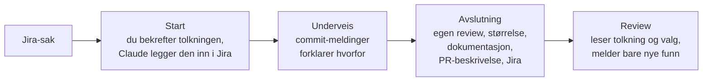

# Arbeidsflyt med Claude Code

**Status:** Forslag til diskusjon · **Ansvarlig:** Leif Halvor Sunde · **Sist oppdatert:** 2026-10-28

Dette er et forslag til hvordan vi bruker Claude Code i utviklingsarbeidet: hvilke skills og hooks vi bruker i hver fase, hvilke konvensjoner de bygger på, og hvordan vi tar dem i bruk. Forslaget følger opp [møtet om KI og utviklingsprosessen 28. oktober 2026](https://arkitektum.atlassian.net/wiki/spaces/ARK/pages/5180030996/M+tenotat+-+20261028). Det bygger på [Retningslinjer for bruk av Claude Code](https://arkitektum.atlassian.net/wiki/spaces/ARK/pages/4595515394/Retningslinjer+for+bruk+av+Claude+Code) og tar utgangspunkt i at du kjører Claude Code i [claude-docker](https://github.com/Arkitektum/claude-docker).

Denne filen er hovedversjonen. Confluence-siden er en kortversjon som lenker hit.

## Hvorfor vi trenger dette

Forslaget skal løse tre problemer:

- **Tolkningen forsvinner.** En sak går gjennom flere ledd før den blir kode: idé → Jira-sak → utviklerens tolkning → prompt → kode. Hvert ledd mister noe, og i dag er det bare koden som blir igjen. Når noe viser seg å være feil, kan ingen se hvordan saken ble forstått, eller hvilke valg som ble tatt.
- **Beslutninger når ikke fram til revieweren.** Når revieweren kjører en agent-review, finner den ofte ting som forfatteren allerede har vurdert og bevisst latt være. Men det står ingen steder.
- **PR-ene er for store** til at noen orker å lese dem.

Erfaringen med Claude varierer i bedriften. Derfor må det felles oppsettet være nyttig også for dem som ikke har satt opp noe selv.

## Prinsipper

1. **Det som må skje, skjer automatisk.** Du skal ikke trenge å huske det, og du skal få nytte av oppsettet uten å kjenne til skills og hooks.
2. **Hooks for det som må skje, skills for det som kan skje.**
   - *Hook:* et script som Claude Code kjører på faste tidspunkter, for eksempel ved oppstart, før og etter verktøykall og når Claude er ferdig med et svar. En hook kjører alltid.
   - *Skill:* en oppskrift som Claude henter fram når den vurderer at den passer, eller når du ber om den. Det er ikke garantert at den blir brukt.
3. **Claude hjelper deg å følge konvensjonene, men tvinger deg ikke.** Konvensjonene i dette forslaget håndheves ikke i GitHub. Claude foreslår, spør og hjelper, og du bestemmer. Vi vurderer dette på nytt etter noen uker.
4. **Claude stopper alltid det som ikke kan angres.** Hooks blokkerer push, Terraform og produksjonsdatabaser, uansett modus. Alt annet kan du rulle tilbake med git og vurdere i review.
5. **Tolkning og valg lagres der de varer.** De ligger i Jira og i commit-meldinger, ikke i en Claude-sesjon som forsvinner når du kjører `/clear`.

## Slik fungerer flyten



Hver branch hører til én Jira-sak, og nøkkelen står i branchnavnet, for eksempel `feature/PROJ-123-kort-beskrivelse`. Slik henger flyten sammen på tvers av sesjoner, og revieweren får samme kontekst som forfatteren.

### Start

- **Nøkkel i branchnavnet:** Claude henter saken, skriver hvordan den forstår den, og vurderer om den bør deles i flere PR-er. Du bekrefter eller retter tolkningen, og Claude legger den inn som kommentar i Jira. Saksteksten står urørt, slik at både den opprinnelige teksten og tolkningen er synlige. Da kan den som skrev saken, oppdage misforståelser før koden er skrevet.
- **Ingen nøkkel:** Claude spør hvilken sak det gjelder. Finnes det ingen sak, tilbyr Claude å opprette sak og branch ut fra det du forteller.
- **Branch som starter med `chore/`:** Flyten er av. Bruk dette til småfikser som ikke trenger en egen sak.

### Underveis

- **Jobb med én sak per sesjon.** Bytter du branch midt i en sesjon, eller blir konteksten stor, foreslår Claude `handoff` og `/clear`.
- **Skriv hvorfor i commit-meldingen** når du har tatt et valg. Claude bygger oppsummeringen på commit-meldingene.
- **Legg mekaniske endringer i egne commits.** Det gjelder for eksempel navnebytter, formatering og flytting av filer. Da kan revieweren hoppe over dem.
- **Claude committer bare når du ber om det.** Du kan committe så ofte du vil. Mangler branchen Jira-nøkkel, spør Claude før den committer, men den blokkerer ikke.

### Avslutning

Når du sier at du er ferdig, eller ber om en PR-beskrivelse, kjører Claude avslutningsskillen:

1. Claude rydder i endringene med `/simplify`.
2. Claude gjør egen review med `/code-review high`. Funn i kode som PR-en endrer, fikser Claude som standard. Funn som ikke gjelder PR-en, blir egne saker i Jira. Hvert funn får én av tre merkelapper: **fikset**, **bevisst latt være** (med én setning om hvorfor) eller **egen sak**.
3. Claude sjekker størrelsen. Er endringen over terskelen, foreslår Claude å dele den opp før du lager PR.
4. Claude oppdaterer dokumentasjonen som endringen berører, for eksempel README-er, ADR-er og CLAUDE.md. Oppdateringen kommer i samme PR.
5. Claude skriver PR-beskrivelsen etter PR-retningslinjene. Den har en egen seksjon om egen review: hvilken review som ble kjørt, på hvilken commit, og hvilke funn som bevisst er latt være. Endrer PR-en en kontrakt som andre systemer bruker, ifølge CLAUDE.md, skriver Claude også hvilke systemer som kan bli påvirket.
6. Claude skriver oppsummeringen til Jira, på høyst rundt ti linjer. Du godkjenner den før Claude legger den inn. Oppsummeringen har tre deler:
   - **Tolkning:** hva vi forsto at saken gikk ut på.
   - **Løsning:** hva vi gjorde, med lenke til PR-en.
   - **Avvik og valg:** hva vi valgte bort, og hvor løsningen avviker fra saken.

Starter du en sesjon på en branch som har commits, men ingen oppsummering, minner Claude deg på det.

### Review

Du sjekker ut branchen lokalt. Review-skillen henter tolkningen og valgene fra Jira via nøkkelen i branchnavnet. Den bruker samme review-nivå som forfatteren og melder bare **nye** funn. I tillegg sier den fra hvis den er uenig i en begrunnelse. Nye funn følger samme regel som i egen review: Forfatteren fikser det som gjelder PR-en, og resten blir egne saker.

Manuell review er fortsatt greit. I prosjekter med mye forretningslogikk er det ofte det riktige. Tolkningen og valgene er nyttige der også.

En agent-review finner alltid noe, og to kjøringer finner ikke det samme. At du finner mye, betyr derfor ikke at forfatteren har hoppet over egen review.

## Skills og hooks i hver fase

| Fase | Skjer automatisk | Kan brukes ved behov | Status |
|---|---|---|---|
| Hele tiden | Arkitektum-instruksjoner · harde stopp (push, Terraform, produksjonsdatabaser) · kommentarbudsjett · formatering · kontekstvarsler | `check-package`, `handoff` | Finnes: instruksjoner, `check-package`. Ny: harde stopp, kontekstvarsler. Flyttes: kommentarbudsjett, formatering, `handoff`. |
| Start | Hente Jira-sak, skrive tolkning, vurdere oppdeling | `grilling` eller `grill-with-docs` når saken er uklar, `to-issues` for å dele opp | Finnes: `grilling`, `grill-with-docs`. Ny: hooken. Flyttes: `to-issues`. |
| Design | – | `domain-modeling`, `prototype`, `brainstorming` | Finnes: `domain-modeling`. Flyttes: `prototype`. Fra superpowers: `brainstorming`. |
| Implementering | Commit-sjekk (Jira-nøkkel i branchnavnet) | `tdd`, OWASP-skills når endringen berører sikkerhet | Finnes: OWASP-skills. Ny: commit-sjekken. Flyttes: `tdd`. |
| Feilsøking | – | `diagnose` | Flyttes: `diagnose`. |
| Avslutning | Påminnelse ved oppstart hvis oppsummeringen mangler | Avslutningsskill (bruker `/simplify` og `/code-review`) | Ny. |
| Review | – | Review-skill | Ny. |
| Vedlikehold | Lenkesjekk av CLAUDE.md ved oppstart | `improve-codebase-architecture`, `setup-domain-docs` | Finnes: `setup-domain-docs`. Ny: lenkesjekken. Flyttes: `improve-codebase-architecture`. |

- **Kommentarbudsjettet** sjekker at kodekommentarer er korte (høyst to linjer) og bare beskriver eksterne fakta.
- **Kontekstvarslene** sier fra når du bytter branch midt i en sesjon, eller når konteksten blir stor.
- **Flyttes** betyr at skillen eller hooken finnes i et personlig oppsett og må inn i marketplacet. Flere av skillene er skrevet av Matt Pocock, så vi sjekker lisensen før vi kopierer dem.

### Hvilken plugin som inneholder hva

| Plugin | Innhold | Slått på som standard |
|---|---|---|
| `arkitektum-mandatory` | Instruksjoner, `check-package`, harde stopp, sperre mot endringer i IDE-oppsett | Ja, alltid |
| `arkitektum-workflow` (ny) | Jira-flyt, avslutning, review, kontekstvarsler, kommentarbudsjett, formatering, lenkesjekk | Ja, men kan skrus av |
| `arkitektum-development` | Grilling, domenemodell og skillene som flyttes inn | Ja |
| `arkitektum-security` | OWASP-skills | Ja |
| superpowers (offisiell) | Fast prosess for brainstorming, planer, TDD og feilsøking | Nei, men anbefalt |

## Slik slår du på flyten i et repo

Legg til filen `.claude/jira.json` i repoet:

```json
{ "project": "PROJ" }
```

Finnes filen, er flyten på. Claude bruker prosjektnøkkelen når den oppretter nye saker. Adressen til Jira er lik for alle og ligger i pluginen. Formatet er bare en skisse. Vi bestemmer det endelige formatet når vi bygger pluginen.

## Mal for CLAUDE.md

Møtet foreslo at alle repoer skal ha en CLAUDE.md. Prosessen ligger i pluginene, så CLAUDE.md i repoet skal bare inneholde det som repoet ikke kan fortelle selv. Står noe allerede i en annen fil, lenker du til den i stedet for å kopiere.

```markdown
# <Prosjektnavn>

<Én–to setninger: hva dette er, og hvem som bruker det.>

## Kommandoer
- Bygg: `...`
- Test: `...`
- Kjør lokalt: `...`

## Forretningslogikk
<Hvor den ligger. Reviewere og Claude starter her.>

## Fallgruver
- <Det som ikke går fram av koden: ting som må skje i en bestemt rekkefølge, kjente feller.>

## Avhengigheter

### Dette repoet bruker
- <System>: <hva vi bruker det til>. <Det som ikke går fram av koden: testmiljø, begrensninger, hva som skjer når det er nede.>

### Dette repoet brukes av
<Ta bare med denne delen hvis andre systemer bruker repoet.>
- <System>: bruker <kontrakt, for eksempel `api/openapi.yaml` eller hendelsen `SakOpprettet`>.

Endringer i kontraktene over må være bakoverkompatible, eller avtales med dem som bruker dem.

## Dokumentasjon
- [Domene og begreper](CONTEXT.md)
- [Arkitekturbeslutninger](docs/adr/)
- [<Modul>](src/<modul>/README.md)
```

Det som Claude må vite i hver sesjon, for eksempel regelen om kontrakter, skal stå direkte i CLAUDE.md. En vanlig lenke lastes ikke inn automatisk. Claude leser filen bak lenken bare hvis den selv vurderer at det trengs. Blir en seksjon lang, kan du flytte den til en egen fil og importere den med `@docs/filnavn.md`. Da lastes filen inn i hver sesjon.

## Hva som finnes, og hva vi må bygge

| Del | Status | Merknad |
|---|---|---|
| Harde stopp i `arkitektum-mandatory` | Må bygges | Liten jobb som ikke avhenger av resten. I dag er forbudene bare instruksjoner som Claude følger etter eget skjønn. |
| Branchens livsløp: start, commit, avslutning, review | Må bygges | Ny plugin: `arkitektum-workflow`. |
| Hygiene: kommentarbudsjett, formatering, kontekstvarsler, lenkesjekk | Finnes delvis i et personlig oppsett | Kommentarbudsjettet må bare sjekke filer som Claude har endret, ikke utviklerens egne endringer som ikke er committet. |
| Skills fra personlig oppsett | Må flyttes til marketplacet | Vi sjekker lisensen først. |
| claude-docker slår på `arkitektum-workflow` | Må bygges | På samme måte som `arkitektum-mandatory` slås på i dag. |

## Forhold til annet arbeid

- **PR-mal og automatisk kontroll av PR-er** er et eget arbeid som følger av møtet. Seksjonen om egen review og review-skillen må passe inn der. Review-skillen kan også kjøre som en del av den automatiske kontrollen i GitHub.
- **Vibe-coding** krever en egen beslutning og er ikke en del av dette forslaget.
- **[Kodestandard og utviklingspraksis](https://arkitektum.atlassian.net/wiki/spaces/ARK/pages/4696014852/Kodestandard+og+utviklingspraksis):** Formateringen i dette forslaget bruker verktøyene som er beskrevet der.

## Forutsetninger og risiko

- **Forslaget forutsetter claude-docker.** Der slås pluginene på automatisk. Kjører noen Claude Code utenfor containeren, er det ingen som sjekker at pluginene er på. Da gjelder verken de harde stoppene eller flyten.
- **Atlassian-koblingen må være slått på for alle.** Brannmuren i claude-docker slipper gjennom `.atlassian.com`, men ikke `.atlassian.net`. Dette må vi teste i piloten.
- **Uten harde krav dekker flyten bare arbeid som går gjennom Claude.** Brancher og commits som lages utenfor Claude, fanges ikke opp.
- **For mye støy gjør at folk skrur av hookene.** Derfor må tersklene kunne justeres.

## Plan for utrulling

1. Vi legger inn de harde stoppene i `arkitektum-mandatory`. Dette kan gjøres uavhengig av resten.
2. Vi diskuterer og justerer forslaget.
3. Vi bygger `arkitektum-workflow` og flytter skillene inn.
4. **Pilot:** To–tre personer tester flyten på ekte saker i et par uker, gjerne med ulik erfaring med Claude og ulikt syn på auto mode.
5. Vi viser flyten med ekte saker fra piloten.
6. Vi slår flyten på for alle. Etter noen uker vurderer vi:
   - Følger folk konvensjonene?
   - Leser noen Jira-kommentarene?
   - Spør hookene for ofte?
   - Trenger vi en PR-sjekk i GitHub likevel?

## Beslutninger som må tas

1. **Auto mode.** Retningslinjene tillater allerede automatisk godkjenning i claude-docker med brannmur. Forslag: Behold det, også for kodeendringer. Kodeendringer kan rulles tilbake og vurderes i review. Må du godkjenne hver redigering, blir det fort et automatisk «ja». De harde stoppene gjør dette tryggere.
2. **Superpowers.** Forslag: Anbefal superpowers, men ikke slå den på som standard. Den gir god struktur, men legger en fast prosess over hver samtale.
3. **Hva som skal fikses.** Forslag: Fiks (nesten) alt som kan fikses i koden PR-en endrer. Det koster lite nå. Vil du la et funn være, skriver du én setning om hvorfor. Alle funn som ikke gjelder PR-en, blir egne saker, slik at PR-en ikke vokser. Bruk `/code-review high` både til egen review og når du reviewer andres kode.
4. **PR-retningslinjer.** Vi avklarer seksjonen om egen review med dem som lager PR-malen.
5. **Terskler.** Vi setter tersklene for kontekststørrelse og størrelse på endringer i piloten.
6. **Detaljer per mappe.** Møtet foreslo egne `context.md`-filer per mappe, slik at Claude bare leser detaljene når det trengs. Claude laster ikke slike filer automatisk, men den laster `CLAUDE.md` i en undermappe automatisk når den jobber med filer der. Forslag: Bruk `CLAUDE.md` i undermapper. Har mappen en README, kan `CLAUDE.md` bare inneholde `@README.md`. Navnet `CONTEXT.md` brukes allerede til ordlisten for domenet, og på Windows og macOS er `context.md` og `CONTEXT.md` samme fil.
